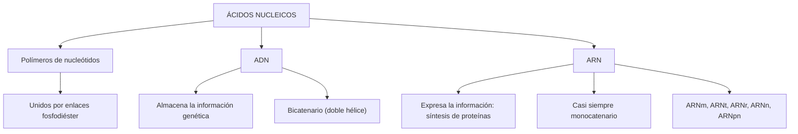
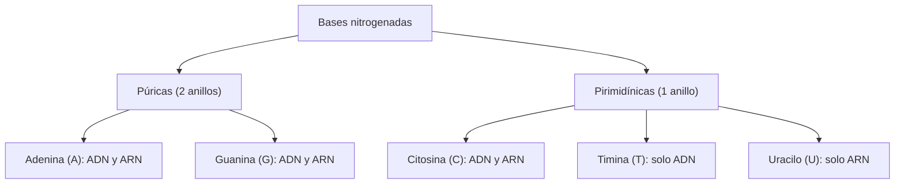
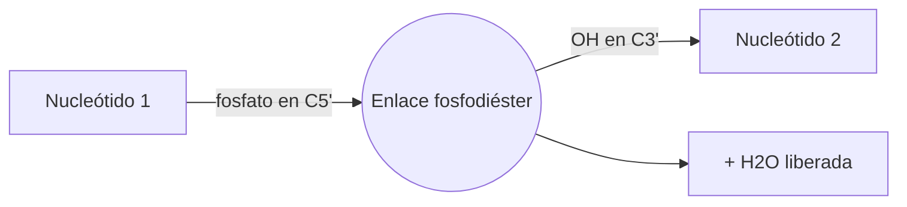
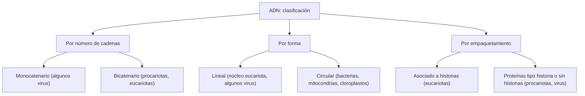
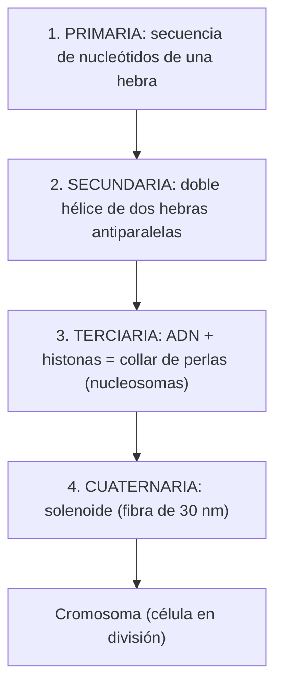
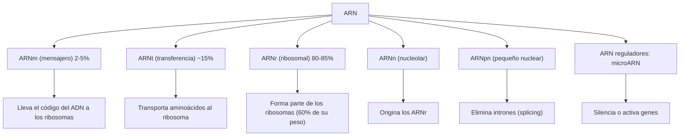
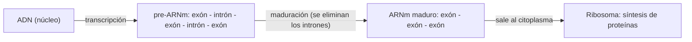

# Ácidos nucleicos: ADN, ARN y nucleótidos explicados paso a paso

> **Resumen rápido:** Los **ácidos nucleicos** (ADN y ARN) son las moléculas que **almacenan, conservan, transmiten y expresan** la información genética de todos los seres vivos. En este artículo verás cómo se construyen (nucleótidos), cómo se organiza el ADN en cada nivel estructural, qué tipos de ARN existen y en qué se diferencian ADN y ARN.


<!-- FOTO SUGERIDA (Unsplash/Pexels): buscar "DNA double helix 3D render" o "DNA structure blue". Cambia la URL de arriba por la de la foto elegida. -->

## Índice

1. [Introducción: ¿qué son los ácidos nucleicos?](#1-introducción-qué-son-los-ácidos-nucleicos)
2. [El nucleótido: la unidad básica](#2-el-nucleótido-la-unidad-básica)
3. [Componentes moleculares](#3-componentes-moleculares-del-nucleótido)
4. [El enlace fosfodiéster y la polaridad 5'→3'](#4-el-enlace-fosfodiéster-y-la-polaridad-53)
5. [ADN: localización y tipos](#5-adn-localización-y-tipos)
6. [Niveles de organización del ADN](#6-niveles-de-organización-estructural-del-adn)
7. [ARN: estructura](#7-arn-estructura)
8. [Tipos de ARN](#8-tipos-de-arn-y-sus-funciones)
9. [Tabla comparativa ADN vs ARN](#9-tabla-comparativa-adn-vs-arn)
10. [Funciones de los ácidos nucleicos](#10-funciones-biológicas-de-los-ácidos-nucleicos)
11. [Preguntas frecuentes de repaso](#11-preguntas-frecuentes-de-repaso)
12. [Glosario](#12-glosario-de-términos-difíciles)

---

## 1. Introducción: ¿qué son los ácidos nucleicos?

Los ácidos nucleicos son **biomoléculas** (moléculas propias de los seres vivos) formadas por cinco elementos: **carbono (C), hidrógeno (H), oxígeno (O), nitrógeno (N) y fósforo (P)**. Son [**polímeros**](#g-polimero) (cadenas largas) construidos por la unión de unidades repetidas llamadas [**nucleótidos**](#g-nucleotido), unidos mediante [**enlaces fosfodiéster**](#g-fosfodiester).

Existen dos tipos:

- **ADN** (ácido **d**esoxirribo**n**ucleico)
- **ARN** (ácido **r**ibo**n**ucleico)

Están presentes en todas las células, desde bacterias hasta organismos eucariotas complejos. Los [**virus**](#g-virus) no se consideran seres vivos estrictos, pero su genoma también es un ácido nucleico, por lo que se clasifican en **virus de ADN** y **virus de ARN**.

> **Dos preguntas para guiar tu estudio** (planteadas en clase tras un video introductorio):
> 1. ¿Cuáles son las diferencias estructurales y funcionales entre el ADN y el ARN?
> 2. ¿Por qué el ADN debe formar una molécula de ARN?
>
> **Idea clave:** el ADN *guarda* la información genética; el ARN permite *leerla y convertirla* en moléculas funcionales mediante la síntesis de proteínas.

### Mapa conceptual general



---

## 2. El nucleótido: la unidad básica

Un **nucleótido** es una molécula orgánica formada por la unión covalente de tres componentes:

1. Una **base nitrogenada** (púrica o pirimidínica).
2. Una **pentosa** (azúcar de cinco carbonos).
3. Uno, dos o tres **grupos fosfato**.

El [**nucleósido**](#g-nucleosido) es la parte formada **únicamente por la base nitrogenada y la pentosa**, unidas por un [**enlace N-glucosídico**](#g-glucosidico). Cuando el nucleósido se une a uno o más fosfatos, se convierte en nucleótido. Los nucleótidos tienen un **fuerte carácter ácido**.

```
[ Base nitrogenada ] + [ Pentosa ]          = NUCLEÓSIDO
[ Nucleósido ]       + [ Grupo(s) fosfato ] = NUCLEÓTIDO
```


### Grados de fosforilación

| Fosfatos | Nombre | Ejemplo |
| :--- | :--- | :--- |
| 1 | Nucleótido monofosfatado | Adenosín-5'-monofosfato (**AMP**) |
| 2 | Nucleótido difosfatado | Adenosín-5'-difosfato (**ADP**) |
| 3 | Nucleótido trifosfatado | Adenosín-5'-trifosfato (**ATP**), molécula clave de transferencia de energía |


<!-- FOTO/DIAGRAMA SUGERIDO: buscar "nucleotide structure diagram" o "molecular model chemistry" en Pexels/Unsplash. -->

---

## 3. Componentes moleculares del nucleótido

### 3.1 Bases nitrogenadas

Son compuestos cíclicos ricos en nitrógeno, derivados de dos estructuras madre.

**Bases púricas** (derivadas de la [**purina**](#g-purina), anillo doble):
- **Adenina (A)** y **Guanina (G)**: presentes en el ADN y en el ARN.

**Bases pirimidínicas** (derivadas de la [**pirimidina**](#g-pirimidina), anillo sencillo):
- **Citosina (C)**: en ADN y ARN.
- **Timina (T)**: exclusiva del **ADN**.
- **Uracilo (U)**: exclusivo del **ARN**.

```
Púricas (2 anillos):        Adenina (A), Guanina (G)
Pirimidínicas (1 anillo):   Citosina (C), Timina (T, ADN), Uracilo (U, ARN)
```

> **Truco para recordar:** las **PUR**inas son **A** y **G** (en inglés: *PURe As Gold*). Las pirimidinas son las otras tres: **C, T y U**. Y recuerda que la **T**imina va en el ADN y el **U**racilo en el ARN: nunca coinciden en la misma molécula.



### 3.2 Pentosas: ribosa y desoxirribosa

| Pentosa | Se encuentra en | Diferencia en el carbono 2' |
| :--- | :--- | :--- |
| **Ribosa** | ARN | Tiene un grupo hidroxilo (**–OH**) |
| **Desoxirribosa** | ADN | Solo tiene un hidrógeno (**–H**): le falta un oxígeno |

> **Nota de clase:** aunque la diferencia es de un solo átomo de oxígeno, este cambio determina una enorme diferencia en la **estabilidad** y en las propiedades biológicas de ambos ácidos nucleicos.


<!-- FOTO/DIAGRAMA SUGERIDO: buscar "sugar molecule model" o "chemistry molecule structure" en Unsplash. -->

### 3.3 Nomenclatura de nucleótidos

| Ácido nucleico | Azúcar | Nucleótidos (monofosfato) | Bases |
| :--- | :--- | :--- | :--- |
| **ARN** (ribonucleótidos) | Ribosa | AMP, GMP, CMP, UMP | A, G, C, U |
| **ADN** (desoxirribonucleótidos) | Desoxirribosa | dAMP, dGMP, dCMP, dTMP | A, G, C, T |

> En biología molecular se usan solo **las iniciales de las bases** para simplificar: **A, G, C, T, U**. La "d" delante de la sigla indica **desoxi**.

---

## 4. El enlace fosfodiéster y la polaridad 5'→3'

El **enlace fosfodiéster** es el enlace covalente que se forma entre el **fosfato del carbono 5'** de un nucleótido y el **grupo hidroxilo (–OH) del carbono 3'** del nucleótido siguiente. En cada enlace se **libera una molécula de agua (H₂O)**. Así, un grupo fosfato queda unido por dos enlaces éster a dos nucleótidos sucesivos.

Consecuencias importantes:

- La cadena tiene **dirección** (polaridad). Su secuencia se escribe **de izquierda a derecha, en sentido 5' → 3'**.
- **Extremo 5':** fosfato libre.
- **Extremo 3':** hidroxilo (–OH) libre.



### Según su longitud

- **Oligonucleótidos:** cadenas cortas, de aproximadamente hasta **50 nucleótidos**.
- **Polinucleótidos:** cadenas más largas.

---

## 5. ADN: localización y tipos

El **ADN** es un polímero de nucleótidos que contiene la información genética necesaria para construir y hacer funcionar las células. Su forma y ubicación dependen del tipo de organismo.

### 5.1 En procariotas

- ADN **circular bicatenario**, organizado en el [**nucleoide**](#g-nucleoide) (región sin membrana, en el citoplasma).
- Asociado a proteínas parecidas a histonas (**NAPs**, proteínas asociadas al nucleoide).
- Presentan además [**plásmidos**](#g-plasmido): moléculas circulares pequeñas y extracromosómicas con pocos genes, algunos de ellos de **resistencia a los antibióticos**.


<!-- FOTO SUGERIDA (Unsplash/Pexels): "bacteria microscope" o "bacteria electron microscopy". -->

### 5.2 En eucariotas

- **ADN nuclear:** **lineal bicatenario**, asociado a [**histonas**](#g-histona) dentro del núcleo. Cuando la célula **no** se divide se llama [**cromatina**](#g-cromatina); al dividirse se condensa en [**cromosomas**](#g-cromosoma).
- **ADN organelar** (mitocondrias y cloroplastos): **circular bicatenario**, forma su propio nucleoide, carece de envoltura nuclear y también se asocia a proteínas.

> **Nota de clase: Teoría endosimbiótica.** La forma circular del ADN mitocondrial y de cloroplastos, sin membrana nuclear, es una prueba clave de la [**teoría endosimbiótica**](#g-endosimbiotica): estos organelos habrían surgido de procariotas que se establecieron dentro de células primitivas.

> **Nota de clase: Herencia mitocondrial.** El ADN mitocondrial se hereda por **línea materna**: en la fecundación, el óvulo aporta casi todo el citoplasma y los organelos, y el espermatozoide aporta básicamente su material genético nuclear. Por eso se usa para **rastrear ancestría materna** en biología evolutiva.

### 5.3 En virus

El genoma está dentro de la [**cápside**](#g-capside) y puede ser **ADN o ARN, lineal o circular, monocatenario o bicatenario**.

### Resumen por tipo de organización

| Organismo | Tipo de ADN |
| :--- | :--- |
| **Procariotas** | Circular, bicatenario, unido a proteínas parecidas a histonas; forma el nucleoide |
| **Eucariotas** | Lineal, bicatenario, unido a histonas en el núcleo; circular en mitocondrias y cloroplastos |
| **Virus** | Lineal o circular, mono o bicatenario, dentro de la cápside |



### Elementos genéticos (Madigan et al., 2015)

| Organismo | Elemento | Tipo de ácido nucleico | Descripción |
| :--- | :--- | :--- | :--- |
| Procariota | Cromosoma | ADN bicatenario | Extremadamente largo, normalmente circular |
| Eucariota | Cromosoma | ADN bicatenario | Extremadamente largo, lineal |
| Todos | Plásmido | ADN bicatenario | Circular o lineal, corto, extracromosómico (raro en eucariotas) |
| Todos | Elemento transponible | ADN bicatenario | Siempre insertado en otra molécula de ADN |
| Mitocondria o cloroplasto | Genoma de orgánulos | ADN bicatenario | Longitud media, normalmente circular |
| Virus | Genoma vírico | ADN o ARN, mono o bicatenario | Relativamente corto, circular o lineal |

---

## 6. Niveles de organización estructural del ADN

```
Estructura primaria    → Secuencia lineal de nucleótidos (5' → 3')
Estructura secundaria  → Doble hélice (Watson y Crick, cadenas antiparalelas)
Estructura terciaria   → Collar de perlas (ADN + octámero de histonas = nucleosoma)
Estructura cuaternaria → Solenoide (fibra de 30 nm, 6 nucleosomas por vuelta)
```



### 6.1 Estructura primaria

Es la **secuencia de nucleótidos de una sola cadena o hebra**, leída de 5' a 3'. Puede ser un filamento extendido o estar algo doblada sobre sí misma. Tiene dos extremos libres: el **5'** (unido a un fosfato) y el **3'** (unido a un hidroxilo).

### 6.2 Estructura secundaria: la doble hélice

Propuesta por **Watson y Crick**: dos cadenas de polinucleótidos **antiparalelas** (una va 5'→3' y la otra 3'→5'), **complementarias** y enrolladas una sobre la otra.

- **Esqueleto azúcar-fosfato** hacia el **exterior** (hidrofílico); **bases nitrogenadas** hacia el **interior** (hidrofóbicas).
- **Complementariedad de bases** mediante [**puentes de hidrógeno**](#g-puentes):
  - **A = T**: 2 puentes de hidrógeno
  - **G ≡ C**: 3 puentes de hidrógeno
- **Dimensiones:** diámetro de **2 nm**; **3.4 nm** por vuelta completa; **0.34 nm** entre pares de bases; unos **10.5 pares de bases por vuelta**.
- Al girar se forman un **surco mayor** y un **surco menor**.


<!-- FOTO SUGERIDA (Pexels/Unsplash): "DNA helix macro" o "genetics laboratory". -->

> **Nota de clase: ¿por qué el ADN es tan estable?** Los **3 puentes G–C**, la estructura **bicatenaria protegida** y los enlaces fosfodiéster le dan gran estabilidad. Por eso se puede aislar ADN viable de muestras biológicas antiguas, algo mucho más difícil con el ARN.

### 6.3 Estructura terciaria

Es la disposición del ADN al asociarse con proteínas para formar los cromosomas.

- **En procariotas:** el ADN se pliega como una **superhélice**, generalmente circular, en bucles o dominios asociados a proteínas NAP.
- **En eucariotas** ("collar de perlas", fibra de 100 Å): el ADN se enrolla alrededor de un [**octámero de histonas**](#g-octamero) formado por **2·H2A + 2·H2B + 2·H3 + 2·H4**. Ese conjunto es el [**nucleosoma**](#g-nucleosoma). Entre nucleosomas está el **ADN espaciador**, asociado a la **histona H1**, que mantiene el ADN en posición (el ADN enrollado con el octámero y la H1 se denomina **cromatosoma**).


<!-- FOTO SUGERIDA (Unsplash): "chromosome microscope" o "microscope cell biology". -->

### 6.4 Estructura cuaternaria

El collar de perlas se enrolla helicoidalmente formando el [**solenoide**](#g-solenoide) (fibra de **30 nm** o **300 Å**), con **6 nucleosomas por vuelta**. Esto **acorta hasta 5 veces** la longitud de la fibra nucleosómica.

---

## 7. ARN: estructura

El **ARN** está formado por **ribonucleótidos** (con ribosa) y las bases **adenina, guanina, citosina y uracilo**. Los nucleótidos se unen por enlaces fosfodiéster en sentido 5'→3', como en el ADN, pero el ARN es **casi siempre monocatenario**. Está presente en virus, procariotas y eucariotas, y su misión principal es **usar la información del ADN para sintetizar proteínas**.

- **Estructura primaria:** secuencia de ribonucleótidos de la cadena.
- **Estructura secundaria:** la cadena se pliega y forma zonas con puentes de hidrógeno **A–U** y **G–C**, generando [**horquillas**](#g-horquilla) (doble hélice corta) y **bucles**.


<!-- FOTO SUGERIDA (Pexels): "RNA molecule illustration" o "molecular biology lab". -->

---

## 8. Tipos de ARN y sus funciones



### 8.1 ARN mensajero (ARNm)

- **Monocatenario**, básicamente lineal; solo constituye el **2-5 %** del ARN total.
- **Función:** tomar la información del ADN (en el núcleo) y llevarla al citoplasma, donde están los ribosomas.
- Se forma a partir de una hebra de ADN en un proceso llamado [**transcripción**](#g-transcripcion).

| Característica | ARNm eucariótico | ARNm procariótico |
| :--- | :--- | :--- |
| **Organización** | [**Monocistrónico**](#g-monocistronico): información para una sola cadena polipeptídica | [**Policistrónico**](#g-policistronico): información separada para varias proteínas |
| **Transcrito inicial** | **pre-ARNm**, con [**exones**](#g-exon) (codificantes) e [**intrones**](#g-intron) (no codificantes) | No tiene intrones |
| **Maduración** | Sí, en el núcleo: se pierden los intrones (*splicing*) | No pasa por maduración |



### 8.2 ARN de transferencia (ARNt)

- Representa cerca del **15 %** del ARN y mide unos **80 nucleótidos**; está disperso en el citoplasma.
- **Transporta aminoácidos** a los ribosomas según la secuencia del ARNm.
- Existe una molécula de ARNt específica para cada aminoácido, con un triplete propio de bases: el [**anticodón**](#g-anticodon).
- Es monocatenario, pero con zonas complementarias dentro de la misma cadena (**complementariedad intracatenaria**), lo que da su forma de **hoja de trébol**.

> **Nota de clase:** hay 20 aminoácidos que forman las proteínas, así que existen **al menos 20 tipos de ARNt**, cada uno como un "vehículo especializado" para su aminoácido.

**Partes del ARNt:**

1. **Extremo 3':** termina siempre en **–C–C–A**. El –OH de la adenina terminal se une al grupo carboxilo del aminoácido.
2. **Extremo 5':** tiene siempre una **guanina (G)** con un fosfato libre.
3. **Brazo y asa del anticodón:** el anticodón es **complementario al codón** del ARNm.
4. **Brazo D y su asa:** contiene **dihidrouridina** (de ahí la "D").
5. **Brazo T y su asa:** se llama así por contener **timina**.


<!-- DIAGRAMA SUGERIDO: busca "tRNA cloverleaf" o "ribosome translation" en Wikimedia Commons, o una foto de laboratorio en Pexels. -->

### 8.3 ARN ribosomal (ARNr)

- Es el **más abundante** (**80-85 %** del ARN) y forma parte de los **ribosomas**, donde constituye el **60 % de su peso** (el resto son proteínas).
- Tiene segmentos lineales y segmentos en doble hélice (estructura secundaria).
- Su tamaño se expresa en [**unidades Svedberg (S)**](#g-svedberg).

| Ribosoma | Total | Subunidad mayor | Subunidad menor | Diámetro aprox. |
| :--- | :--- | :--- | :--- | :--- |
| **Procariota** | **70 S** | 50 S | 30 S | 29 nm |
| **Eucariota** | **80 S** | 60 S | 40 S | 32 nm |

> **Ojo:** los valores S **no se suman** (50 S + 30 S = **70 S**, no 80 S), porque el coeficiente depende de la forma y densidad de la partícula al ensamblarse.

### 8.4 Otros ARN especializados

- **ARN nucleolar (ARNn):** forma parte del nucléolo. Se origina en la [**región organizadora nucleolar (NOR)**](#g-nor) del ADN y se fragmenta para dar origen a los distintos ARNr.
- **ARN pequeño nuclear (ARNpn o ARN-U):** en el núcleo eucariota, rico en **uracilo**. Se une a proteínas formando ribonucleoproteínas que **eliminan intrones** (maduración del ARNm).
- **ARN reguladores (microARN, ARN de interferencia):** moléculas pequeñas que silencian o activan genes.

---

## 9. Tabla comparativa ADN vs ARN

| Característica | ADN | ARN |
| :--- | :--- | :--- |
| **Número de cadenas** | Doble cadena (bicatenario), doble hélice | Una cadena (monocatenario), puede plegarse |
| **Azúcar** | Desoxirribosa | Ribosa |
| **Bases** | A, **T**, C, G | A, **U**, C, G |
| **Apareamiento** | A–T (2 enlaces H), C–G (3 enlaces H) | A–U (2 enlaces H), C–G (3 enlaces H) en regiones de doble hebra |
| **Función principal** | Almacenar y transmitir la información genética | Síntesis de proteínas (ARNm, ARNt, ARNr), regulación y catálisis (ribozimas) |
| **Localización** | Núcleo (también mitocondrias y cloroplastos) | Núcleo y citoplasma |
| **Estabilidad** | Muy estable | Menos estable; se degrada con facilidad |

*Fuente de la tabla en clase: Audesirk, T., & Byers, B. E. (2008). Biología: La vida en la Tierra. Pearson Educación.*

---

## 10. Funciones biológicas de los ácidos nucleicos

1. **Almacenar, conservar y transmitir** la información genética de generación en generación.
2. **Mantener la identidad de las especies.**
3. **Mantener las diferencias individuales** dentro de una misma especie.
4. **Articular la expresión de la información genética** por medio de la síntesis de proteínas.
5. **Dirigir la diferenciación de tejidos y células** mediante la expresión selectiva de ciertos genes.

---

## 11. Preguntas frecuentes de repaso

**¿Cuál es la diferencia entre nucleósido y nucleótido?**
El nucleósido es base + pentosa; el nucleótido es nucleósido + uno o más fosfatos.

**¿Qué base cambia entre ADN y ARN?**
El ADN tiene **timina**; el ARN tiene **uracilo**.

**¿Por qué el ADN es más estable que el ARN?**
Por la desoxirribosa (sin –OH en C2'), la doble cadena protegida y los 3 puentes de hidrógeno G–C.

**¿Cuántos puentes de hidrógeno hay en A–T y en G–C?**
Dos y tres, respectivamente.

**¿Por qué el ADN debe formar ARN?**
Porque el ADN permanece protegido en el núcleo y el ARN copia y lleva la información a los ribosomas del citoplasma, donde se fabrican las proteínas.

**¿Cómo se llama el ADN del núcleo cuando la célula no se divide?**
Cromatina.

---

## 12. Glosario de términos difíciles

<a id="g-anticodon"></a>**Anticodón:** triplete de bases del ARNt complementario al codón del ARNm.

<a id="g-capside"></a>**Cápside:** cubierta de proteínas que protege el material genético de un virus.

<a id="g-cromatina"></a>**Cromatina:** ADN asociado a proteínas (histonas) en el núcleo cuando la célula no se está dividiendo.

<a id="g-cromosoma"></a>**Cromosoma:** estructura formada por ADN muy condensado y proteínas, visible durante la división celular.

<a id="g-endosimbiotica"></a>**Teoría endosimbiótica:** propone que mitocondrias y cloroplastos fueron procariotas que pasaron a vivir dentro de otras células.

<a id="g-exon"></a>**Exón:** segmento del pre-ARNm que se conserva en el ARNm maduro y codifica información.

<a id="g-fosfodiester"></a>**Enlace fosfodiéster:** enlace covalente entre el fosfato del C5' de un nucleótido y el –OH del C3' del siguiente.

<a id="g-glucosidico"></a>**Enlace N-glucosídico:** enlace que une la base nitrogenada con la pentosa en el nucleósido.

<a id="g-histona"></a>**Histona:** proteína básica alrededor de la cual se enrolla el ADN eucariota.

<a id="g-horquilla"></a>**Horquilla:** zona de doble hélice corta que se forma cuando una cadena de ARN se pliega sobre sí misma.

<a id="g-intron"></a>**Intrón:** segmento no codificante del pre-ARNm que se elimina durante la maduración.

<a id="g-monocistronico"></a>**Monocistrónico:** ARNm que contiene información para una sola cadena polipeptídica.

<a id="g-policistronico"></a>**Policistrónico:** ARNm que contiene información para sintetizar varias proteínas distintas.

<a id="g-nor"></a>**Región organizadora nucleolar (NOR):** región del ADN a partir de la cual se origina el ARN nucleolar.

<a id="g-nucleoide"></a>**Nucleoide:** región del citoplasma procariota donde se concentra el ADN, sin membrana que lo rodee.

<a id="g-nucleosido"></a>**Nucleósido:** base nitrogenada unida a una pentosa (sin fosfato).

<a id="g-nucleosoma"></a>**Nucleosoma:** unidad básica de empaquetamiento del ADN eucariota: ADN enrollado sobre un octámero de histonas.

<a id="g-nucleotido"></a>**Nucleótido:** unidad del ácido nucleico formada por base nitrogenada, pentosa y fosfato(s).

<a id="g-octamero"></a>**Octámero de histonas:** conjunto de 8 histonas (2 H2A, 2 H2B, 2 H3, 2 H4).

<a id="g-plasmido"></a>**Plásmido:** molécula de ADN pequeña, circular y extracromosómica, común en bacterias.

<a id="g-polimero"></a>**Polímero:** molécula grande formada por la repetición de unidades más pequeñas (monómeros).

<a id="g-puentes"></a>**Puente de hidrógeno:** unión débil que mantiene juntas las bases complementarias de las dos hebras.

<a id="g-purina"></a>**Purina:** estructura de doble anillo de la que derivan la adenina y la guanina.

<a id="g-pirimidina"></a>**Pirimidina:** estructura de anillo sencillo de la que derivan citosina, timina y uracilo.

<a id="g-solenoide"></a>**Solenoide:** fibra de 30 nm formada al enrollarse el collar de perlas, con 6 nucleosomas por vuelta.

<a id="g-svedberg"></a>**Unidad Svedberg (S):** medida de la velocidad de sedimentación de una partícula al centrifugarla; se usa para ribosomas y ARNr.

<a id="g-transcripcion"></a>**Transcripción:** proceso por el cual se sintetiza ARN a partir de una hebra de ADN.

<a id="g-virus"></a>**Virus:** entidad acelular con genoma de ADN o ARN que necesita una célula para replicarse.

---

*Basado en la clase de Genética Molecular, Eje Temático 2 (Profa. Osiris Murcia, UNACHI, FCNYE, Segundo Semestre 2026), el PDF de apoyo y la transcripción de la clase.*
