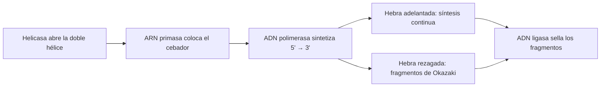
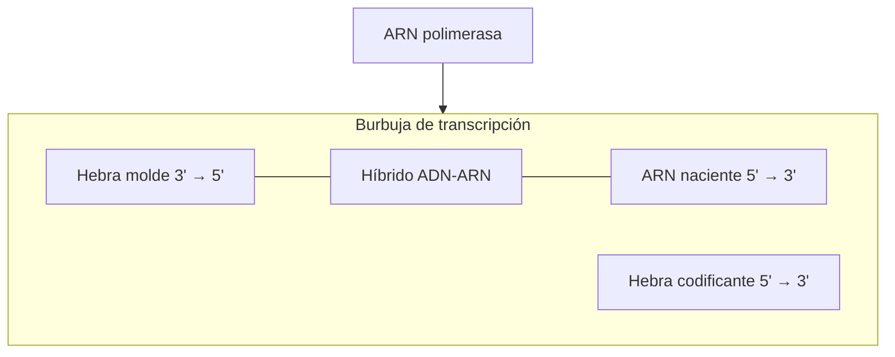
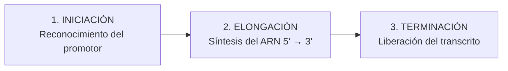
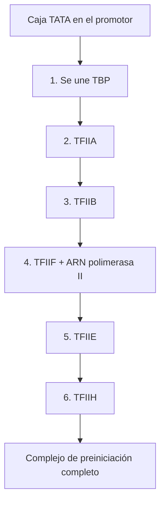
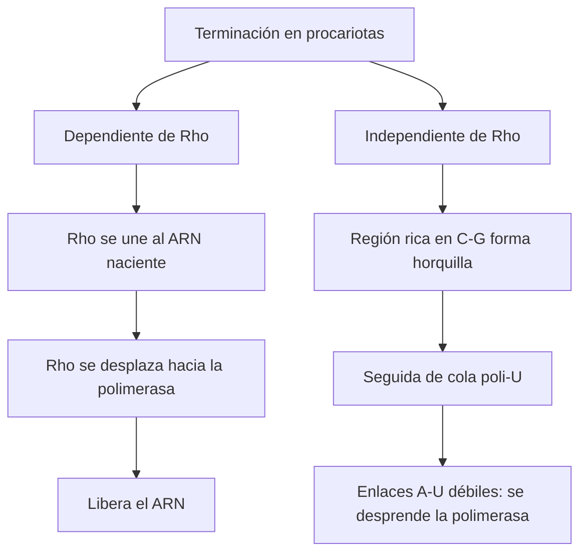
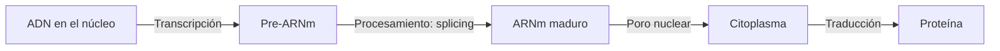

# Transcripción del ADN: cómo la célula copia la información genética en ARN

> **Resumen:** La **transcripción** es el proceso mediante el cual la información de un gen en el ADN se copia a una molécula de ARN. Es el primer paso de la expresión génica. En esta guía repasamos sus características, las enzimas que participan, sus tres fases (iniciación, elongación y terminación) y las diferencias entre procariotas y eucariotas.

**Palabras clave:** transcripción del ADN, ARN polimerasa, promotor, caja TATA, hebra molde, expresión génica, genética molecular, terminación Rho.

*Eje Temático 2: Genética Molecular. Basado en la clase de la Profesora Osiris Murcia, Segundo Semestre 2026.*

---

## Índice

1. Repaso previo: la replicación del ADN
2. ¿Qué es la transcripción del ADN?
3. Cuatro características de la transcripción
4. Hebra molde y hebra codificante
5. La ARN polimerasa
6. Fases de la transcripción
7. Destino del transcrito: procariotas vs. eucariotas
8. Resumen comparativo
9. Glosario

---

## 1. Repaso previo: la replicación del ADN

Antes de estudiar la transcripción conviene recordar la **replicación**, el proceso que duplica el ADN antes de la división celular.


*Imagen sugerida: modelo de doble hélice de ADN. Si la URL no carga, busca en Unsplash o Pexels "DNA double helix".*

### Maquinaria enzimática de la replicación

- **ADN polimerasa:** enzima que añade desoxirribonucleótidos y sintetiza las nuevas cadenas.
- **Helicasa:** enzima que rompe los **puentes de hidrógeno** de la doble hélice y la abre.
- **ARN primasa:** enzima que agrega el **cebador** (*primer*), un fragmento corto de ARN que marca el sitio de inicio.
- **ADN ligasa:** enzima que sella los fragmentos sintetizados.
- **Actividad exonucleasa:** función de la ADN polimerasa que **corrige errores** cuando añade un nucleótido equivocado, de modo que el ADN se copie idéntico.

### Características de la replicación

- Ocurre siempre en dirección **5'→3'**.
- Como la doble hélice es **antiparalela**, una hebra se sintetiza de forma continua (**hebra adelantada**) y la otra de forma discontinua, en tramos llamados **fragmentos de Okazaki**.
- Parte de un **origen de replicación**: el **OriC** en procariotas o múltiples **replicones** en eucariotas.
- Es **bidireccional, secuencial y semiconservativa**: cada molécula hija conserva una cadena parental y tiene una cadena nueva.
- Ocurre en el nucleoide/citoplasma en procariotas y en el núcleo en eucariotas, específicamente en la **fase S** de la interfase.



---

## 2. ¿Qué es la transcripción del ADN?

En las rutas de transmisión de la información genética, la **transcripción** es el proceso de transferencia de la información contenida en el ADN a una molécula de ARN. Una secuencia de **desoxirribonucleótidos** se convierte en información escrita en una secuencia de **ribonucleótidos**.

Es el **primer paso de la expresión génica** (transcripción y posterior traducción). Mediante esta ruta se sintetizan todos los tipos de ARN de la célula:

- **ARNm** (mensajero)
- **ARNr** (ribosomal)
- **ARNt** (de transferencia)
- **ARNpn** (pequeños nucleares) y **ARNpc** (pequeños citoplasmáticos)
- **miARN** (microARN) y **ARN de interferencia**

### Una analogía para entenderla

Imagina que te entregan un libro de texto de 500 páginas y solo te piden copiar un capítulo. No irías a la fotocopiadora a copiar todo el libro: solo necesitas 10 hojas. Así funciona la transcripción: la célula **no copia todo el genoma**, solo el gen o los genes que necesita en ese momento. Esto ocurre cada vez que la célula requiere un producto génico específico, como una hormona proteica o una enzima metabólica (por ejemplo, los citocromos).


*Imagen sugerida: libro abierto o biblioteca. Alternativa: buscar "open book pages" en Pexels.*

---

## 3. Cuatro características de la transcripción

| # | Característica | Qué significa |
|---|---|---|
| 1 | **Proceso selectivo** | Se limita a una porción del ADN; debe reconocerse un punto de inicio y uno de terminación. |
| 2 | **Proceso reiterativo** | Puede repetirse infinidad de veces durante la vida de la célula (a diferencia de la replicación, que marca la división celular). Una región de ADN puede dar muchas moléculas iguales de ARN. |
| 3 | **Proceso conservador** | No afecta la estructura del ADN: las cadenas se separan temporalmente y luego se reúnen, y el gen copiado queda intacto. |
| 4 | **Proceso monocatenario** | Solo participa **una** de las dos cadenas del ADN, y el ARN resultante es una molécula de **cadena sencilla**. |

---

## 4. Hebra molde y hebra codificante

Como solo se copia una cadena, es importante distinguirlas:

- **Hebra molde (3'→5'):** la cadena que **lee la ARN polimerasa** para incorporar los ribonucleótidos complementarios.
- **Hebra codificante o no molde (5'→3'):** su secuencia es **idéntica a la del ARN**, con una única diferencia: la **timina (T)** del ADN se reemplaza por **uracilo (U)** en el ARN.

**Ejemplo práctico**

```text
Hebra codificante  5'  A T G A T C T C G T A A  3'
ARN                5'  A U G A U C U C G U A A  3'   (síntesis 5' → 3')
Hebra molde        3'  T A C T A G A G C A T T  5'
```

> **Dato clave:** el ARN en formación es **antiparalelo** a la hebra molde: se lee la molde en sentido 3'→5' y el ARN crece en sentido 5'→3'.

---

## 5. La ARN polimerasa: la enzima protagonista

La reacción la cataliza la **ARN polimerasa dependiente de ADN**, que forma los distintos tipos de ARN a partir de los **ribonucleótidos activados** (ATP, GTP, CTP y UTP). Establece el **enlace fosfodiéster** uniendo el extremo **5'** del nucleótido entrante con el extremo **3'** libre de la cadena en crecimiento. Por eso la **dirección de síntesis es 5'→3'**.


*Imagen sugerida: laboratorio de biología molecular. Alternativa: buscar "molecular biology lab" en Pexels.*

### La burbuja de transcripción y el híbrido ADN-ARN

Al llegar al promotor, la enzima desenrolla un segmento del ADN y forma la **burbuja de transcripción**. Dentro de ella se forma de manera transitoria una doble hélice entre la hebra molde y el ARN naciente, llamada **híbrido ADN-ARN**.



### 5.1 ARN polimerasa en procariotas (bacterias)

- **Una sola enzima** sintetiza todos los tipos de ARN: ARNm, ARNr y ARNt.
- Es un complejo de **6 subunidades**: un **núcleo (core)** de 5 subunidades (α, α, β, β', ω) y una sexta subunidad, el **factor sigma (σ)**, que se une en los momentos iniciales para reconocer el promotor.
- **Carece de actividad exonucleasa**, por lo que comete errores en una proporción de **1 por cada 10⁴ a 10⁵ ribonucleótidos**. Evolutivamente puede ser una ventaja, porque genera variaciones o isoformas proteicas.
- Su organización génica es **policistrónica**: un mismo promotor y un mismo transcrito codifican varios genes o enzimas que actúan de forma coordinada en una misma ruta metabólica.

### 5.2 ARN polimerasas en eucariotas

Las células eucariotas tienen **tres** ARN polimerasas especializadas:

| Enzima | Localización / función | Productos principales |
|---|---|---|
| **ARN polimerasa I** | Nucléolo | Precursores del **ARN ribosomal** |
| **ARN polimerasa II** | Complejo multienzimático de **12 subunidades** (550 kDa) | Precursores de **ARNm**, microARN y otros |
| **ARN polimerasa III** | Núcleo | **ARNt**, ARNr 5S y ARN pequeños nucleares y citoplasmáticos |

Particularidades de la **ARN polimerasa II**:

- Su unión a los promotores **depende de factores de transcripción**.
- Puede iniciar la síntesis **en ausencia de cebador**.

En eucariotas la organización génica es **monocistrónica**: cada gen tiene su propio promotor y codifica un solo ARNm y su proteína.

---

## 6. Fases de la transcripción

El proceso ocurre en tres etapas consecutivas.




*Imagen sugerida: ADN o genética a gran detalle. Alternativa: buscar "DNA strand" o "genetics" en Pexels.*

### Fase 1: Iniciación

La ARN polimerasa debe reconocer el **punto de inicio** de la síntesis, una zona del ADN llamada **promotor**. El promotor contiene secuencias que permiten a la enzima, o a sus proteínas auxiliares, unirse al ADN. Está ubicado **"aguas arriba"**, hacia el extremo 5' de la cadena molde respecto al sitio de inicio **+1**. Cuando la enzima llega al promotor, el ADN se desenrolla y se forma la burbuja de transcripción.

#### Promotores en procariotas

El promotor bacteriano consiste en **dos secuencias consenso** muy conservadas:

- **Elemento -35:** a 35 pares de bases del inicio (secuencia **TTGACA/TTGACG**).
- **Elemento -10 (caja de Pribnow):** a 10 pares de bases del inicio (secuencia **TATAAT**).

> **¿Por qué se abre el ADN en el elemento -10?** Porque es rico en pares **adenina-timina (A-T)**, que solo tienen **dos puentes de hidrógeno**, por lo que las cadenas se separan con mayor facilidad.

#### Promotores en eucariotas

Su arquitectura es más compleja:

- **Elementos de control proximal:** **caja GC** (-100, GGGCGG) y **caja CAAT** (-80, GCCCAATCT).
- **Promotor núcleo (core):** **caja TATA** (-25, TATAAA), con una función muy parecida al elemento -10 bacteriano.

Aquí la ARN polimerasa II **no se une directamente al ADN**: necesita **factores de transcripción (TF)** que se ensamblan en orden:

1. La proteína **TBP** (*TATA-Binding Protein*) se une primero a la caja TATA.
2. Se reclutan después **TFIIA, TFIIB, TFIIF** (unido a la ARN pol II), **TFIIE y TFIIH**.
3. El conjunto forma el **complejo de preiniciación**.



### Fase 2: Elongación

La hebra molde actúa como **plantilla**. La ARN polimerasa avanza leyéndola en sentido **3'→5'**, base por base, y construye el ARN con nucleótidos complementarios en sentido **5'→3'**.

**Una imagen histórica: los "árboles de Navidad".** En las micrografías electrónicas de la transcripción del ARN ribosomal se observan estructuras que parecen arbolitos de Navidad. Son una de las primeras evidencias gráficas de la transcripción. Aparecen así porque **muchas ARN polimerasas transcriben simultáneamente el mismo gen, una detrás de otra**. En el punto de inicio (extremo 5') los transcritos son cortos y hacia el final (extremo 3') los transcritos primarios están casi completos.


*Imagen sugerida: busca en Wikimedia Commons "Miller spread rRNA transcription" o "Christmas tree transcription electron micrograph" (imagen original de la micrografía de transcripción de ARNr).*

### Fase 3: Terminación

Las secuencias llamadas **terminadores** indican que la transcripción está completa. Al transcribirse, provocan que la polimerasa se disocie y libere el ARN. En bacterias hay dos estrategias:

#### Terminación dependiente de Rho

1. El ARN naciente contiene un **sitio de unión** para el **factor Rho**, una proteína hexamérica.
2. Rho se une y se "desplaza" por el transcrito hacia la ARN polimerasa.
3. Al alcanzarla, **desestabiliza la interacción** y libera el ARN.

#### Terminación independiente de Rho (intrínseca)

Depende solo de la secuencia sintetizada:

1. La polimerasa transcribe una región **rica en C y G**.
2. El ARN se **pliega sobre sí mismo** por complementariedad de bases y forma una **horquilla (bucle troncal)** estable.
3. La horquilla va seguida de un tramo corto de **uracilos (cola poli-U)**.
4. Las interacciones **A-U** entre el ARN y la plantilla de ADN son muy débiles, así que, con la pausa causada por la horquilla, la polimerasa **se desprende**.



---

## 7. Destino del transcrito: procariotas vs. eucariotas

Un transcrito listo para usarse en la traducción se llama **ARN mensajero (ARNm)**.

### En procariotas

No hay envoltura nuclear, así que **transcripción y traducción están acopladas** en el citoplasma. Mientras el ARNm se sintetiza, los **ribosomas** se unen a él. Un ARNm traducido por varios ribosomas forma un **polirribosoma**.

### En eucariotas

El transcrito primario (**pre-ARNm**) se sintetiza en el núcleo y debe **madurar** antes de salir por los **poros nucleares** hacia el citoplasma. En el procesamiento intervienen:

- **Exones:** regiones **codificantes** que permanecen en el ARNm maduro.
- **Intrones:** regiones **no codificantes** intercaladas que se eliminan durante el **empalme (*splicing*)**.



---

## 8. Resumen comparativo

| Aspecto | Procariotas | Eucariotas |
|---|---|---|
| Lugar | Citoplasma / nucleoide | Núcleo |
| ARN polimerasas | **Una** para todos los ARN | **Tres** (I, II y III) |
| Reconocimiento del promotor | Factor sigma (σ) | Factores de transcripción (TBP, TFII...) |
| Elementos del promotor | -35 y -10 (Pribnow) | Caja GC, caja CAAT, caja TATA |
| Organización génica | Policistrónica | Monocistrónica |
| Terminación | Dependiente e independiente de Rho | (Procesamiento posterior del pre-ARNm) |
| Procesamiento del ARNm | No | Sí (exones, intrones, splicing) |
| Transcripción y traducción | Acopladas | Separadas (núcleo / citoplasma) |

---

## 9. Glosario

- **ADN ligasa:** enzima que sella los fragmentos de ADN sintetizados.
- **ADN polimerasa:** enzima que sintetiza nuevas cadenas de ADN en la replicación.
- **Antiparalelo:** que corre en sentido opuesto; las dos hebras del ADN tienen orientaciones 5'→3' y 3'→5'.
- **ARNm (ARN mensajero):** ARN que lleva la información de un gen para ser traducida a proteína.
- **ARN polimerasa:** enzima que sintetiza ARN usando una hebra de ADN como molde.
- **Caja TATA:** secuencia del promotor eucariota (TATAAA, posición -25) análoga al elemento -10 bacteriano.
- **Cebador (primer):** fragmento corto de ARN que marca el inicio de la replicación.
- **Enlace fosfodiéster:** unión covalente entre nucleótidos consecutivos de una cadena.
- **Exón:** región codificante que se conserva en el ARNm maduro.
- **Exonucleasa (actividad):** función que corrige errores eliminando el nucleótido mal incorporado.
- **Expresión génica:** conjunto de procesos (transcripción y traducción) por los que un gen origina su producto.
- **Factor sigma (σ):** subunidad de la ARN polimerasa bacteriana que reconoce el promotor.
- **Factores de transcripción:** proteínas que ayudan a la ARN polimerasa eucariota a unirse al promotor.
- **Fragmentos de Okazaki:** tramos cortos de ADN sintetizados de forma discontinua en la hebra rezagada.
- **Hebra codificante:** cadena de ADN con la misma secuencia que el ARN (con T en lugar de U).
- **Hebra molde:** cadena de ADN que se lee para sintetizar el ARN.
- **Helicasa:** enzima que abre la doble hélice rompiendo los puentes de hidrógeno.
- **Híbrido ADN-ARN:** doble hélice transitoria entre la hebra molde y el ARN naciente.
- **Horquilla (bucle troncal):** estructura que forma el ARN al plegarse sobre sí mismo.
- **Intrón:** región no codificante que se elimina durante el splicing.
- **Monocistrónico / policistrónico:** un solo gen por transcrito / varios genes por transcrito.
- **OriC:** origen de replicación de los cromosomas procariotas.
- **Polirribosoma:** ARNm traducido simultáneamente por varios ribosomas.
- **Promotor:** secuencia de ADN donde se une la ARN polimerasa para iniciar la transcripción.
- **Replicón:** unidad de replicación del ADN con su propio origen.
- **Factor Rho (ρ):** proteína hexamérica que participa en una forma de terminación bacteriana.
- **Splicing (empalme):** proceso que elimina intrones y une exones.
- **TBP:** proteína de unión a la caja TATA, primer factor en ensamblarse.
- **Terminador:** secuencia que señala el final de la transcripción.
- **Transcripción:** síntesis de ARN a partir de una plantilla de ADN.

---

### Conclusión

La transcripción es un proceso **selectivo, reiterativo, conservador y monocatenario** que permite a la célula producir exactamente el ARN que necesita, cuando lo necesita. Entender sus fases, el papel del promotor y las diferencias entre procariotas y eucariotas es la base para comprender la traducción y la regulación génica.

---

**Notas para publicar:**

- Las URLs de Unsplash son ilustrativas y pueden cambiar. Si alguna no carga, usa el texto en cursiva debajo de cada imagen como guía de búsqueda.
- Para las figuras específicas de la clase (burbuja de transcripción, complejo de preiniciación, micrografía de "árboles de Navidad"), usa los diagramas originales de la presentación o de Wikimedia Commons, que tienen licencias abiertas.
- Los bloques `mermaid` se renderizan directamente si tu web usa Mermaid.js (o plataformas como GitHub, Docusaurus u Obsidian).
- Sugerencia SEO, *meta title*: "Transcripción del ADN: fases, ARN polimerasa y promotores". *Meta description*: "Aprende qué es la transcripción del ADN, sus fases (iniciación, elongación y terminación), las ARN polimerasas y las diferencias entre procariotas y eucariotas."
